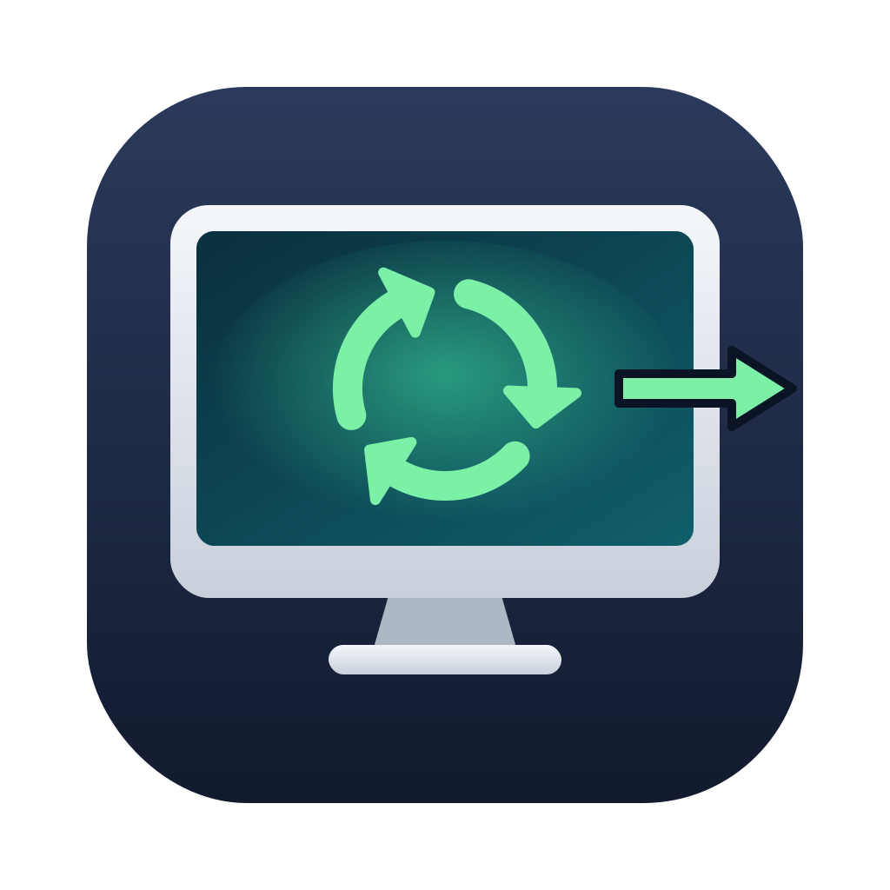
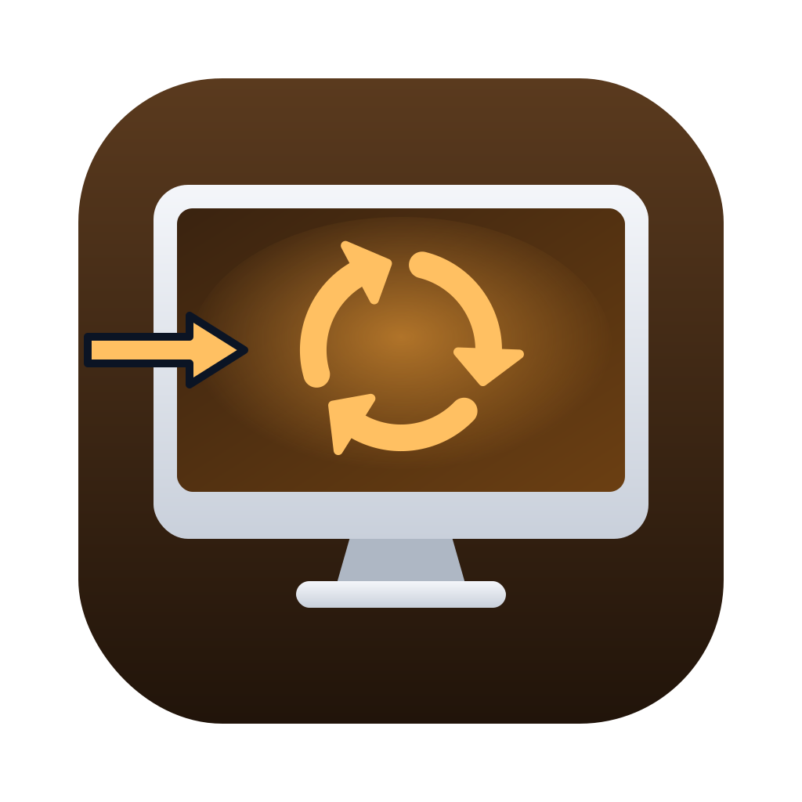

<p align="center"> </p>

# Screen3R

**Use an old Mac as a second display for your new Mac or your Windows PC — over your local network.**

*Reduce, Reuse, Recycle* — the three R's, applied to a screen that still works perfectly.

Got a 2011 iMac with a perfectly good screen that nothing supports any more?
Target Display Mode doesn't work with Apple Silicon, and modern screen-extension
apps need Metal or a newer macOS on the old machine. Screen3R needs neither:

- **Screen3R** (menu bar app) runs on the new Mac — macOS 13 Ventura or later, Apple Silicon or Intel.
  It creates a real virtual monitor, captures it and streams it as low-latency H.264.
- **Screen3R Viewer** runs on the old Mac — **macOS 10.13 High Sierra or later**, Intel, no Metal required.
  It shows the stream full screen, decoded through VideoToolbox / AVFoundation.
- **Screen3R for Windows** (notification-area app) runs on a Windows 10 or 11 PC and sends one of its
  displays to the same viewer. See [Windows PC](#windows-pc).

No cables to buy: Ethernet or Wi-Fi on the same network. Free and open source (GNU GPL v3).

> **Status: v0.4, experimental.** Built for a 21.5" iMac mid-2011 (iMac12,1, Radeon HD 6750M,
> High Sierra) + MacBook Pro M4. Written by Claude (Anthropic's AI assistant) and provided as is:
> see [Who made this, and support](#who-made-this-and-support).

## How it works

```
 New Mac                                              Old Mac
 ┌────────────────────────────────┐  TCP :52020     ┌───────────────────────────────┐
 │ virtual display                │                 │ Screen3R Viewer               │
 │  → ScreenCaptureKit (60 fps)   │ ──────────────▶ │  AVSampleBufferDisplayLayer   │
 │  → VideoToolbox H.264          │  H.264 frames   │  (hardware/software decode)   │
 │    low-latency, no B-frames    │ ◀────────────── │  full screen                  │
 └────────────────────────────────┘  acks, pings    └───────────────────────────────┘
```

- Only changed frames are sent: a still desktop uses almost no bandwidth.
- When the screen stops changing (150 ms), the last image is re-encoded once at near-lossless quality,
  so small text ends up sharp even on the Wi-Fi preset.
- Per-frame acknowledgements, sent after decoding, cap the number of frames in flight, so latency stays low
  on slow Wi-Fi or a slow old Mac (frames are skipped instead of queued).
- The menu shows live fps, bandwidth, round-trip time and whether the old Mac decodes in hardware.
- You keep using the new Mac's keyboard and trackpad: the virtual display is part of its desktop.
  Optionally, the **old Mac's keyboard and mouse** control the new Mac too, on every screen.
- The mouse pointer is not part of the video: its position is sent separately every few milliseconds
  and the viewer draws it itself, so it moves with network latency only.

Wire protocol: [PROTOCOL.md](PROTOCOL.md).

## Download

Ready-made apps are on the **Releases** page: `Screen3R-x.y.z.zip` for the new Mac,
`Screen3R-Viewer-x.y.z.zip` for the old one, and `SHA256SUMS.txt`. For Windows:
`Screen3R-Windows-x64-x.y.z.zip` (most PCs) or `…-arm64-…` (Windows on ARM), each also as a
smaller `…-needs-dotnet10.zip`, with `SHA256SUMS-Windows.txt` (see [Windows PC](#windows-pc)).

Screen3R is a free project, so the apps are **not signed with an Apple Developer ID and not
notarized** (that needs a paid Apple membership). They work just the same, but macOS is wary of them:

- **First launch on the new Mac.**
  - macOS 15 Sequoia or later: double-click the app; macOS says it could not verify it, click *Done*.
    Open **System Settings › Privacy & Security**, scroll down to *"Screen3R" was blocked…* and click
    **Open Anyway** (macOS asks for your password).
  - macOS 13–14: right-click the app › *Open* › *Open*.
- **First launch on the old Mac:** right-click the app › *Open* › *Open*. If macOS says the app is
  damaged: `xattr -cr "/Applications/Screen3R Viewer.app"`.
- **After every update** macOS treats the new version as a different app, because each release has
  its own signature:
  1. *Screen Recording*: System Settings may still show the old permission as enabled, but it no
     longer works. Run `tccutil reset ScreenCapture io.github.screen3r.host` in Terminal, open
     Screen3R, allow it, then quit and reopen it.
  2. If macOS asks whether Screen3R may use its keychain items (the pairing keys), enter your password
     and click *Always Allow*. If you click *Deny*, you just pair the two Macs again.
  3. *Local Network* and *Accessibility* (if you use the old Mac's keyboard and mouse) on the new Mac,
     and the firewall on the old Mac, may need allowing again too.
- **Checking a download:** `shasum -a 256 Screen3R-*.zip` must print the same values as `SHA256SUMS.txt`.

None of this is needed if you build the apps yourself with your own certificate (below): then the
permissions stay across updates.

## Build

On the **new** Mac, with Xcode or just the Command Line Tools (`xcode-select --install`):

```sh
git clone https://github.com/fablabromagna-org/Screen3R.git
cd Screen3R
./build.sh
```

You get `build/Screen3R.app` and `build/Screen3R Viewer.app` (plus zips).

### Keep the Screen Recording permission across rebuilds

macOS remembers privacy permissions by the app's code signature. Without a certificate the apps
are signed ad-hoc, every build gets a new signature, and macOS stops recognising the permission
(it still looks enabled in System Settings, but the app is denied). Create a free self-signed
certificate once and `build.sh` will use it automatically:

1. **Keychain Access** › menu *Keychain Access* › *Certificate Assistant* › *Create a Certificate…*
2. Name: `Screen3R Dev` · Identity Type: *Self-Signed Root* · Certificate Type: *Code Signing* › *Create*.
3. Run `./build.sh`; when asked whether `codesign` may use the key, enter your password and click *Allow*.
   (*Always Allow* saves typing, but then any program running as you could sign itself with this
   certificate and inherit Screen3R's Screen Recording permission.)

An *Apple Development* certificate (free with an Apple ID in Xcode › Settings › Accounts) is picked up too.

If the permission is already stuck: `tccutil reset ScreenCapture io.github.screen3r.host`,
then open the app, allow it, quit and reopen.
GitHub Actions builds both on every push (see the *Actions* tab for downloadable artifacts).

## Use

1. Copy **Screen3R Viewer.app** to the old Mac (USB stick, file sharing, AirDrop…).
   First launch of a downloaded build: see [Download](#download).
   Allow incoming connections if the firewall asks.
2. Open it. The screen goes black and shows the Mac's name and IP address.
3. On the new Mac, open **Screen3R.app**. Allow **Screen Recording** and **Local Network** when asked
   (System Settings › Privacy & Security). After granting Screen Recording, quit and reopen the app.
4. Click the menu bar icon → pick the old Mac from *Available screens*
   (or *Connect to IP Address…* if Bonjour doesn't find it).
5. **First time only — pairing.** Both Macs show the same 6-digit code. If they match, click
   *Codes Match – Pair* on the new Mac. (If the old Mac is already paired with another Mac, also
   press **Return** on the old Mac.) From then on the two Macs recognise each other automatically.
6. The old Mac becomes an extra screen. Arrange it in **System Settings › Displays**
   (menu → *Arrange Displays…*); macOS remembers the position. To show a copy of your main screen
   instead, choose **Mirror Main Display** in the menu (⌘M while the menu is open).

Quit the viewer with **⌘Q** on the old Mac (**⌃⌥⌘Q** while its keyboard controls the new Mac).

### Using the old Mac's keyboard and mouse

Sitting at the old Mac? Its keyboard and mouse can control the new Mac:

1. In the Screen3R menu choose **Use Old Mac's Keyboard & Mouse** (off by default).
2. The first time, allow Screen3R in **System Settings › Privacy & Security › Accessibility** on the
   new Mac (the menu offers to open it). *Encrypt Stream* must be on.
3. The old Mac shows a short notice. From then on:
   - the mouse moves the new Mac's pointer, also across to its other screens, as a second mouse would;
     clicks, double-clicks, drags and scrolling (with trackpad momentum) work as usual;
   - everything you type goes to the new Mac, shortcuts included (⌘Q, ⌘W, ⌘Tab…);
   - **⌃⌥⌘K** gives the keyboard and mouse back to the old Mac for a moment (to answer a dialog on
     it, for instance); click the picture or press ⌃⌥⌘K again to take control of the new Mac again.
     This happens by itself when another app opens a window over the viewer on the old Mac (a
     Time Machine alert, a software update…), so you can always click it away;
   - **⌃⌥⌘Q** quits the viewer and gives the keyboard and mouse back to the old Mac.

The new Mac's own keyboard and trackpad keep working at the same time. A few shortcuts are handled
by the old Mac's system before any app sees them and stay there: Spotlight (⌘Space), Mission Control,
Launchpad, screenshots (⇧⌘3/4) and the brightness/volume keys. Use the same keyboard layout on both
Macs: the keys are sent, and the new Mac's layout turns them into characters.

### Quality presets

| Preset | Bitrate | Use for |
|---|---|---|
| Wi-Fi | 12 Mbit/s | 802.11n old Macs, busy networks |
| Balanced (default) | 25 Mbit/s | good Wi-Fi / mixed |
| Ethernet | 50 Mbit/s | both Macs wired — sharpest text |

The menu shows live fps, bandwidth and round-trip time.

## Windows PC

**Screen3R for Windows** sends a Windows PC's screen to the same Screen3R Viewer on the old Mac,
with the same pairing, encryption and (optionally) the old Mac's keyboard and mouse.
Windows 10 (1809 or later) or Windows 11, x64 or ARM64. The video is encoded by the PC's graphics
chip (Intel Quick Sync, NVIDIA, AMD) through Media Foundation, or by Windows' own software encoder.

### Install and use

1. Download `Screen3R-Windows-x64-x.y.z.zip` (`arm64` for Windows on ARM), extract
   `Screen3R.exe` anywhere (e.g. your Documents folder) and run it. Nothing else to install:
   .NET is included in the file (about 58 MB).
   If the PC already has the [.NET 10 Desktop Runtime](https://dotnet.microsoft.com/download/dotnet/10.0)
   (or a later one), the smaller `…-needs-dotnet10.zip` (about 27 MB) does the same; without the
   runtime, Windows says so and links to the download. Windows doesn't include .NET by itself.
   The app is not signed: Windows SmartScreen says it protected your PC. Click **More info** ›
   **Run anyway** (once). Check the download against `SHA256SUMS-Windows.txt` if you like
   (`Get-FileHash Screen3R-Windows-*.zip` in PowerShell).
2. The Screen3R icon appears in the notification area next to the clock (on Windows 11 it may be
   hidden behind the **^** arrow; drag it out to keep it visible). Click it.
3. Open **Screen3R Viewer** on the old Mac, then pick it under *Available screens*
   (or *Connect to IP Address…*).
4. First time only: compare the 6-digit code on both screens and click *Codes Match – Pair*
   (as with a Mac; if the old Mac is already paired with another computer, also press Return on it).

To start Screen3R with Windows, put a shortcut to `Screen3R.exe` in the Startup folder
(`Win+R` › `shell:startup`).

### Duplicate or extend?

Windows has no public way for an app to create a virtual monitor, so Screen3R for Windows sends a
display that exists — **Display to Send** in the menu (the main display by default). The old Mac then
shows a copy of it, scaled to fit.

To use the old Mac as an **extra** screen, give Windows one more display to extend onto:

- the free, open-source [Virtual Display Driver](https://github.com/VirtualDrivers/Virtual-Display-Driver)
  (signed, installs a virtual monitor; set its resolution to the old Mac's, e.g. 1920×1080), or
- an HDMI/DisplayPort "dummy plug" (a few euros): Windows sees a monitor.

Then choose that display in *Display to Send* and arrange it in **Settings › System › Display**.

### Keyboard and mouse of the old Mac

As on the Mac (menu › *Use Old Mac's Keyboard & Mouse*, encryption on). Keys are sent as physical
keys and the PC's keyboard layout turns them into characters (use the same layout, e.g. Italian, on
both). By default the Apple keys work as with Boot Camp: **⌘ = Windows key**, ⌃ = Ctrl, ⌥ = Alt and
right ⌥ = **AltGr** (for @ # [ ] { } on European layouts). *Mac Keyboard › ⌘ Command = Ctrl* swaps
⌘ and ⌃ so that ⌘C/⌘V copy and paste as on a Mac. ⌃⌥⌘Q still quits the viewer.

Windows doesn't let normal apps type into programs running as administrator (Task Manager,
installers, …) or into the secure screens (UAC prompts, Ctrl+Alt+Del, the lock screen): use the PC's
own keyboard there. While a UAC prompt is on screen the stream pauses.

### Good to know

- Pairing keys are kept in `%APPDATA%\Screen3R\pairings.json`, encrypted for your Windows account
  (DPAPI); *Security › Forget Paired Screens…* deletes them. Settings are in the same folder.
- Only the chosen display is captured; the pointer is sent only while it is on that display.
- *Open Log* in the menu shows what happened (encoder chosen, why a connection ended):
  `%LOCALAPPDATA%\Screen3R\Screen3R.log`. Please attach it to bug reports.
- Rotated (portrait) displays can't be sent yet.

### Build it yourself

With the [.NET 10 SDK](https://dotnet.microsoft.com/download) (on Windows, macOS or Linux):

```sh
dotnet publish Windows/Screen3R -c Release -r win-x64 -o publish   # -> publish/Screen3R.exe (.NET included)
dotnet publish Windows/Screen3R -c Release -r win-x64 -p:SelfContained=false -o publish-fd   # needs .NET 10
dotnet run -c Release --project Windows/Screen3R.Tests            # protocol and crypto tests
Tests/windows_interop.sh                                           # Linux/macOS: against the Mac apps' C crypto
```

The protocol code (`PeerConnection.cs`, `RdCrypto.cs`) is platform-neutral and is tested against a
simulated viewer built on `Shared/rd_crypto.c`, so the Windows app and the Macs agree byte for byte.

## Security

**What protects you**

- **Pairing.** The first time, both Macs show the same 6-digit code and you confirm that they match
  (as when pairing a Bluetooth device). The Macs then share a secret key and prove it to each other
  on every connection: your screen is never sent to a device pretending to be your old Mac, and a
  stranger can't put things on your old Mac's screen. Once a Mac is paired, any further pairing also
  needs Return pressed on the old Mac.
- **Encryption** (on by default, *Security › Encrypt Stream*). Video, pointer and everything else
  travel encrypted (AES) and authenticated, so other devices on the network can neither watch nor
  alter the stream. The cost is negligible, even on a 2011 iMac. The menu shows "encrypted" while it
  is active.
- Only the virtual display is captured. Your other screens are never recorded or sent. The mouse
  pointer's position and shape are sent only while it is on the virtual display.
- The viewer accepts connections only from the local network (private, link-local and same-subnet
  addresses), never from the internet.
- The viewer runs on Macs that no longer get security updates, so it keeps network data away from
  complex parsers: nothing but the handshake is processed before the other Mac is authenticated, no
  image files are decoded (the pointer arrives as raw pixels), video frames are structure-checked
  before reaching the decoder, sizes are bounded, and a peer that floods it is disconnected.
- The host app is signed with the hardened runtime, so other programs can't inject code into it to
  use its Screen Recording permission.
- **Keyboard & mouse of the old Mac** are off by default and only work in an encrypted session (the
  new Mac ignores them otherwise), so nobody on the network can type into your Mac. Keys and buttons
  still held when the connection drops are released at once.

The details are in [PROTOCOL.md](PROTOCOL.md). The crypto lives in one C file shared by both apps
(`Shared/rd_crypto.c`, CommonCrypto + Security.framework) and is checked by a self-test on every build.

**Good to know**

- Pairing keys are stored in the new Mac's login keychain and, on the old Mac, in
  `~/Library/Application Support/Screen3R Viewer/pairings.plist` (readable only by you).
  *Security › Forget Paired Screens…* removes them on the new Mac; delete that file to reset the old one.
- If you turn encryption off, the connection is still authenticated when it starts, but the stream
  itself can be watched by others on the network, and the old Mac's keyboard and mouse can't be used.
- With *Use Old Mac's Keyboard & Mouse* on, whoever sits at the old Mac can use the new Mac while
  they are connected, as with a keyboard plugged into it. The old Mac runs an unsupported macOS: if
  you think it may be compromised, leave this option off.
- Downloaded builds are signed ad-hoc and not notarized by Apple. If you can, build from source;
  otherwise compare the zip files with the `SHA256SUMS.txt` published next to them (see [Download](#download)).

## Known limitations (v0.4)

- 1× (non-Retina) display only, at the old Mac's native resolution.
- No audio (sound keeps playing on the new Mac).
- H.264 4:2:0: small coloured text can look slightly soft, especially on the Wi-Fi preset.
- Releases are not notarized: macOS warns on first launch and asks for Screen Recording permission
  again after each update (see *Download*). The same happens after each rebuild without a signing
  certificate (see *Build*).
- Old Mac's keyboard: Spotlight, Mission Control, screenshots and media keys act on the old Mac; Caps
  Lock works for typing but its light shows the old Mac's state. Unlocking a locked new Mac from the
  old Mac's keyboard may not work: use the new Mac (or Touch ID).
- Relies on `CGVirtualDisplay`, a private macOS API (also used by DeskPad, BetterDisplay…). A future macOS could break it.
- Windows: mirrors an existing display (extending needs a virtual display driver or a dummy plug, see
  [Windows PC](#windows-pc)); no rotated displays; the executable is not signed (SmartScreen warns once).

## Who made this, and support

Screen3R was written by **Claude**, Anthropic's AI assistant: code, documentation and icons. It came
out of a conversation with the maintainer of this repository, who had the old iMac, asked for the
features, tested every version on real hardware and chose the name.

**Provided as is.** Screen3R is shared in the hope that it is useful, without warranty of any kind
(see [LICENSE](LICENSE)). It is a spare-time project with very limited availability for change requests:
issues and feature requests may go unanswered. Bug reports with logs are still appreciated, and forks
and pull requests are welcome. The code is small and commented, so adapting it to your own Macs
(with an AI assistant, if you like) is often the quickest route.

The app icons are original artwork made for this project (`Icons/*.svg`) and are covered by the
same licence as the code.

## License

Copyright (C) 2026 Screen3R contributors.

Screen3R is free software: you can redistribute it and/or modify it under the terms of the
[GNU General Public License](LICENSE) as published by the Free Software Foundation, either version 3
of the License, or (at your option) any later version. It is distributed in the hope that it will be
useful, but WITHOUT ANY WARRANTY; without even the implied warranty of MERCHANTABILITY or FITNESS FOR A
PARTICULAR PURPOSE. See the GNU General Public License for more details.

In short: you may use, study, change and share Screen3R freely; if you distribute a modified version
(or a program that contains its code), you must do so under the same licence and with its source code.

Screen3R for Windows includes the .NET runtime (in the self-contained build) and the Vortice and
SharpGen libraries, all under the MIT licence: see [THIRD_PARTY_NOTICES.md](THIRD_PARTY_NOTICES.md).

## Roadmap ideas

- HiDPI mode for Retina viewers (2012–2015 MacBook Pros).
- Optional lossless "text mode" (changed tiles only, compressed) for wired connections.
- Remember the last viewer and auto-connect.
- Send Spotlight/Mission Control shortcuts to the new Mac too (needs Accessibility on the old Mac).

## Troubleshooting

- **Stutters every second or so on Wi-Fi** → macOS's AWDL interface (AirDrop/Handoff/Sidecar) makes the Wi-Fi
  card hop channels and adds periodic latency spikes. Test with `sudo ifconfig awdl0 down` on the new Mac
  (`sudo ifconfig awdl0 up` to restore; it also comes back after a restart).

- **Viewer not listed** → use *Connect to IP Address…* with the IP shown on the old Mac; check both Macs are on the same network/VLAN and that Local Network access is allowed.
- **"Screen capture failed"** → enable Screen3R under *Screen & System Audio Recording*, then reopen it.
- **Black screen on the old Mac after connecting** → open Console.app on the old Mac and filter for `Screen3R`; please open an issue with the log.
- **The old Mac shows a full-screen app (e.g. a Windows App/Remote Desktop session) instead of a desktop** →
  that's macOS Spaces: each display shows one Space, a full-screen app is a Space of its own, and when
  the virtual display appears macOS may put a full-screen Space on it (Screen3R gives the old Mac the
  same display identity every time, so macOS also remembers where things were). Choose
  **Reset Old Mac's Screen** in the Screen3R menu: it mirrors and un-mirrors the display, which makes
  macOS set up that screen again.

---

### In italiano, in breve

Screen3R trasforma un vecchio Mac (High Sierra o successivo, anche senza Metal) in un secondo
monitor per un Mac moderno o per un PC Windows, via rete locale. Compila con `./build.sh` sul Mac nuovo, copia
*Screen3R Viewer* sul vecchio Mac e aprilo, poi scegli lo schermo dall'icona di Screen3R nella barra dei menu.

Le app già pronte (pagina *Releases*) non sono notarizzate da Apple. Al primo avvio sul Mac nuovo
(macOS 15 o successivo) vai in *Impostazioni di Sistema › Privacy e sicurezza › Apri comunque*. Sul
vecchio Mac usa tasto destro › *Apri*. Dopo ogni aggiornamento va ridato il permesso di Registrazione
schermo: esegui `tccutil reset ScreenCapture io.github.screen3r.host` e riapri l'app (dettagli in *Download*).

Con *Use Old Mac's Keyboard & Mouse* anche tastiera e mouse del vecchio Mac comandano il Mac nuovo
(serve il permesso Accessibilità sul Mac nuovo e la cifratura attiva); ⌃⌥⌘K li restituisce per un
momento al vecchio Mac (succede da solo se sul vecchio Mac si apre una finestra, per esempio un
avviso di Time Machine; un clic sull'immagine li ridà al Mac nuovo); ⌃⌥⌘Q chiude il viewer.

**Windows:** scarica `Screen3R-Windows-x64-….zip` (con .NET incluso; la variante
`…-needs-dotnet10.zip` è più piccola ma richiede il .NET 10 Desktop Runtime), estrai `Screen3R.exe` e avvialo (al primo
avvio SmartScreen: *Ulteriori informazioni* › *Esegui comunque*). L'icona compare nell'area di
notifica accanto all'orologio. Windows non permette alle app di creare monitor virtuali: Screen3R
duplica uno schermo esistente; per estendere il desktop installa il
[Virtual Display Driver](https://github.com/VirtualDrivers/Virtual-Display-Driver) o usa un
"dummy plug" HDMI e sceglilo in *Display to Send*.

Screen3R è stato scritto da Claude, l'assistente AI di Anthropic, ed è fornito così com'è, senza
garanzie, con una disponibilità molto limitata per richieste di modifiche. Fork e pull request sono benvenuti.
È software libero, distribuito con licenza GNU GPL versione 3 o successiva: puoi usarlo, studiarlo,
modificarlo e condividerlo; chi distribuisce versioni modificate deve farlo con la stessa licenza e
con i sorgenti.
